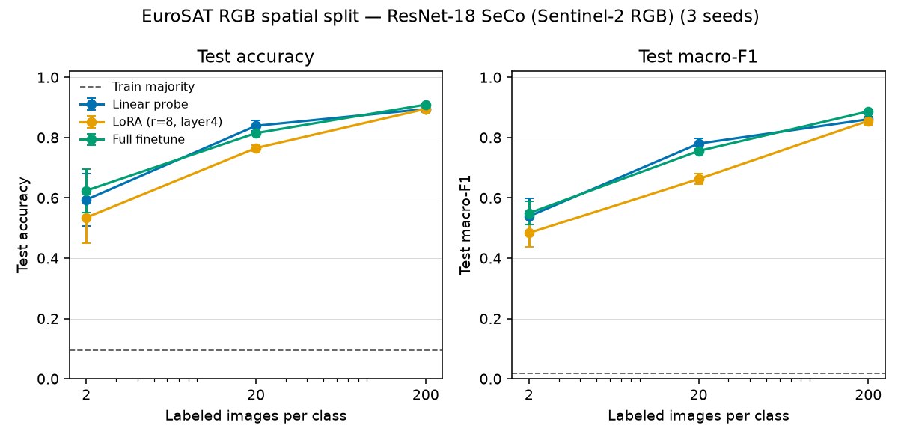

# geo-foundation-adapt

Label-efficiency comparison on EuroSAT RGB: a frozen linear probe, LoRA on a pretrained ResNet-18, and full finetune. Three training seeds. The table in this file is filled from the CPU run of the command in [Reproduce](#reproduce). `--demo` is a separate synthetic fallback and is not that table.

## Problem

Adapting a pretrained encoder to land cover gets expensive if every new label set updates every weight. The practical question is how much of that update is worth paying for when labels are scarce:

1. Does a linear probe on a frozen encoder already beat a majority-class baseline?
2. Does LoRA on the last residual stage pick up accuracy the probe cannot?
3. At what label count does full finetune overtake the cheaper methods, and what does it cost in trainable weights?

## Data

**EuroSAT RGB** (Helber, Bischke, Dengel, and Borth): 27,000 Sentinel-2 chips, 10 land-cover classes, 64×64 JPEG. The zip used here is the TorchGeo / Hugging Face copy of the RGB archive, 94,280,567 bytes, MD5 `c8fa014336c82ac7804f0398fcb19387`.

The 13-band archive (`EuroSATallBands.zip`) is about 2.07 GB, which is outside the download budget, so this benchmark does not use reflectance values. Inputs are the authors' 8-bit RGB rendering.

The split is **TorchGeo `EuroSATSpatial`**: longitude bands, 60/20/20, filename lists vendored under `src/geo_foundation_adapt/splits/` and checked against the TorchGeo SHA-256 pins.

| Split | Chips |
|---|---:|
| Spatial train | 16,200 |
| Spatial val | 5,400 |
| Spatial test | 5,400 |

Class counts are uneven inside those bands (the spatial test band has 115 Pasture chips and 1,077 Forest chips). Macro-F1 is reported for that reason. A random EuroSAT split is not used.

**CPU pool.** Finetuning all 16,200 train chips at 224×224 does not fit the 4-thread hour, so the published command draws a **fixed stratified pool of 200 chips per class** (2,000 chips) from the spatial train band with `pool_seed=0`. Label fractions **1% / 10% / 100%** are fractions of that pool: **2 / 20 / 200 images per class** (20 / 200 / 2,000 labeled chips). Within a seed the smaller subset is a prefix of the larger one. The pool does not depend on the training seed.

Checkpointing uses a **class-balanced 50-per-class slice** of the spatial validation band (`val_seed=0`). The number that is reported is accuracy and macro-F1 on the **full spatial test band** (5,400 chips). That band is not used to pick epochs, learning rates, or the backbone.

## Backbone

**ResNet-18 trained with Seasonal Contrast (SeCo)** on Sentinel-2 RGB (Manas et al., ICCV 2021). Weights are the TorchGeo checkpoint `ResNet18_Weights.SENTINEL2_RGB_SECO` (44,781,193 bytes, SHA-256 `cefca942e0765c9b6dea779e83bb328c8535dc9a3d49fb90e8b294525e8ef891`), loaded into `torchvision.models.resnet18`. TorchGeo itself is not installed; the checkpoint is one file from Hugging Face.

This is a self-supervised Earth-observation encoder. It is **not** a foundation model in the Prithvi / SatMAE / DOFA / Clay sense: the architecture is an 11M-parameter CNN, and the pretraining task is seasonal contrast on RGB rather than masked modeling of multispectral time series. Those weights are left as a later step. A ViT finetune does not fit this CPU budget, and the matching 13-band EuroSAT zip does not fit the download budget.

SeCo's raw-DN quantile stretch expects reflectance, which these JPEGs no longer are. The published preprocessing is the last stage of that pipeline only: scale the 8-bit chip to [0, 1], bilinear-resize 64→224, then ImageNet normalization. `--backbone imagenet` swaps in torchvision `ResNet18_Weights.IMAGENET1K_V1` without changing the protocol. The published table is SeCo.

## Adaptation

Same new 10-way head for every method. No flip augmentation, so the gap is the adaptation rule. Optimizer is AdamW, weight decay 1e-4. Early stopping keeps the earlier epoch on ties. Selection metric is validation macro-F1. Sample standard deviation uses divisor n−1.

| Method | What trains | Learning rate | BatchNorm |
|---|---|---|---|
| `linear_probe` | classification head | 1e-2 | frozen, eval (pretrained running stats) |
| `lora` | head + LoRA on `layer4` 3×3 convs, rank 8, alpha 16 | 1e-3 | frozen, eval |
| `full_finetune` | every weight | head 1e-3, backbone 1e-4 | train mode, running stats update |

LoRA uses the usual convolution factorization: a k×k map down to the rank, then a 1×1 map back, with the second matrix initialized at 0 so step 0 matches the frozen conv. The residual downsample (1×1) stays frozen. The linear probe trains on embeddings extracted once from that frozen eval-mode network; with no augmentation that matches an online frozen forward.

The linear head is allowed 30 epochs and patience 6. An epoch of the head does not touch the ResNet. LoRA and full finetune use a base cap of 8 epochs and patience 3, with a floor of 40 optimizer steps so the 20-image subset is not an 8-step run. At batch size 64 that floor is 40 epochs for 20 images, 10 epochs for 200 images, and it does not extend the 2,000-image run past 8 epochs. The floor is capped at 8× the base epoch count. A discarded one-seed check (not in the table) was still improving LoRA's validation macro-F1 after 8 updates on 20 images; the published rule was set from that, before the three-seed run. Batch size is 64. Seeds are 0, 1, and 2. The head seed is reset per method so method order does not change initialization.

The spatial-train majority baseline predicts the most common class in the full 16,200-chip train band (ties break to the smaller class index) and is scored on the same test chips. It does not depend on the seed. Uniform chance accuracy on 10 classes is 0.10; the spatial split moves class mass, so the train-majority accuracy is not 0.10.

## Reproduce

One block for macOS and for Windows Git Bash. Python 3.12. From the repository root. This command is what writes `results/` and `figures/label_efficiency.png`.

```bash
python3.12 -m venv .venv
source .venv/bin/activate
# Windows PowerShell instead of the line above: .venv\Scripts\Activate.ps1
python -m pip install --upgrade pip
case "$(uname -s)" in
  Darwin) python -m pip install torch torchvision ;;
  *) python -m pip install torch torchvision --index-url https://download.pytorch.org/whl/cpu ;;
esac
python -m pip install -r requirements.txt
python -m pip install -e .
python -m geo_foundation_adapt --out results --data-dir data/eurosat --publish-figures figures
```

The EuroSAT RGB zip is 94,280,567 bytes and the SeCo checkpoint is 44,781,193 bytes (139,061,760 bytes together). Both are gitignored. This machine verified the zip MD5 and the checkpoint SHA-256 during the run below. Offline synthetic fallback, which does not download anything and is a different table:

```bash
python -m geo_foundation_adapt --demo --out output/demo
```

This run was a Linux x86_64 VM, 4 CPU threads, PyTorch 2.14.1+cpu, torchvision 0.29.1+cpu, device `cpu`. Wall time was **3,906 seconds**. Image loading was 4.5 seconds. Frozen-embedding extraction for the linear probe was 90 seconds. A Mac mini was not timed. The same command is the one that produced `results/` and `figures/label_efficiency.png`.

## Results

Mean ± sample standard deviation across seeds 0, 1, and 2. Source files: `results/metrics.json`, `results/metrics_table.csv`, `results/metrics_by_seed.csv`. Accuracy and macro-F1 are on all 5,400 spatial-test chips. The spatial-train majority class is Residential (1,927 of 16,200 train chips). On the test band that class is 507/5,400, so the baseline accuracy is 0.094 and its macro-F1 is 0.017. Uniform chance accuracy is 0.10. The test band's largest class is Forest (1,077 chips), which is the geographic shift in this split.

| Labels / class | Fraction of CPU pool | Method | Accuracy | Macro-F1 | Trainable params |
|---:|---:|---|---:|---:|---:|
| — | — | spatial-train majority | 0.094 | 0.017 | 0 |
| 2 | 1% | Linear probe | 0.594 ± 0.086 | 0.539 ± 0.060 | 5130 |
| 2 | 1% | LoRA (r=8, layer4) | 0.535 ± 0.086 | 0.484 ± 0.046 | 150538 |
| 2 | 1% | Full finetune | 0.624 ± 0.072 | 0.549 ± 0.039 | 11181642 |
| 20 | 10% | Linear probe | 0.839 ± 0.018 | 0.780 ± 0.017 | 5130 |
| 20 | 10% | LoRA (r=8, layer4) | 0.765 ± 0.010 | 0.663 ± 0.017 | 150538 |
| 20 | 10% | Full finetune | 0.815 ± 0.001 | 0.755 ± 0.008 | 11181642 |
| 200 | 100% | Linear probe | 0.895 ± 0.003 | 0.861 ± 0.005 | 5130 |
| 200 | 100% | LoRA (r=8, layer4) | 0.895 ± 0.011 | 0.855 ± 0.012 | 150538 |
| 200 | 100% | Full finetune | 0.909 ± 0.004 | 0.887 ± 0.006 | 11181642 |

With 2 labeled chips per class, every method is far above the majority baseline, and the three means sit inside the seed noise. Full-finetune accuracy is 0.624 ± 0.072, the probe is 0.594 ± 0.086, and LoRA is 0.535 ± 0.086. The per-seed probe accuracies are 0.671, 0.500, and 0.611. Train accuracy at the selected checkpoint is 1.0 for the probe and for full finetune on all three seeds, and for LoRA on two seeds (the other LoRA seed is 0.90). The 20 training chips are memorized. The test number is the part that moves.

With 20 chips per class the ordering is stable. Probe accuracy is higher than LoRA on every seed (0.823, 0.835, 0.858 versus 0.757, 0.775, 0.763). The macro-F1 gap is 0.780 ± 0.017 versus 0.663 ± 0.017. Probe accuracy is also higher than full finetune on every seed (full finetune is 0.814, 0.814, 0.815). The seed-0 macro-F1 values are 0.764 and 0.763, so that one comparison is a tie at the third decimal; the other two seeds favor the probe. LoRA's training accuracy at this budget is 0.85, 0.90, and 0.81, so it has not memorized the 200 chips. Seed 1's LoRA run used the last allowed epoch (10/10). Seeds 0 and 2 stopped earlier on validation and were still behind the probe.

With 200 chips per class, full finetune is ahead on every seed. Macro-F1 is 0.885, 0.882, and 0.893, against the probe's 0.856, 0.865, and 0.861. The mean gap is 0.026. LoRA's accuracy matches the probe (0.895 ± 0.011 versus 0.895 ± 0.003); which of those two wins changes with the seed. Full finetune trains 11,181,642 parameters. LoRA trains 150,538. The probe trains 5,130.



On the confusion matrices summed across the three seeds at 200 chips per class, Pasture is the weak class for every method (recall 0.713 probe, 0.623 LoRA, 0.670 full finetune) and it has only 115 test chips. SeaLake and Forest sit near 0.98–1.00. Full finetune's macro-F1 lead is carried by classes such as Highway (recall 0.950 versus 0.884 for the probe) and River (0.937 versus 0.866), while Pasture recall stays lower than the probe's.

## Limitations

- The published label fractions are 1%, 10%, and 100% of a 200-per-class pool, not of the 16,200-chip spatial train split. Two hundred images per class is a CPU cap chosen so a 224×224 ResNet-18 finetune can finish on 4 threads.
- Checkpoint selection sees 50 validation chips per class, not all 5,400 spatial-val chips. The chosen epoch is noisier than a full-val sweep.
- Three seeds cover the labeled subset and the head/LoRA initialization. They are not a bootstrap over longitude bands. At 2 chips per class the accuracy standard deviation is about 0.07–0.09, so that row does not rank the methods.
- One of the three 20-per-class LoRA runs used its last allowed epoch. The other two stopped on validation and remained behind the probe, which is why the LoRA gap is treated as a real result of this protocol.
- Pasture has 115 spatial-test chips. Its recall stays the lowest class at 200 chips per class, so macro-F1 is sensitive to that class.
- EuroSAT RGB is an 8-bit JPEG, not 13-band reflectance. SeCo was pretrained on quantile-stretched reflectance. The domain gap is real; ImageNet initialization is the implemented control (`--backbone imagenet`) and is not the published table.
- ResNet-18 SeCo is not Prithvi, SatMAE, DOFA, or Clay.
- BatchNorm in full finetune uses batch statistics. At 2 images per class the batch is smaller than 64, so those updates are a harsh test of full finetune rather than a tuned small-batch recipe.
- Learning rates, rank, the step floor, and the 224 input size were fixed for this CPU protocol. They were not swept on the test band. The 40-step floor exists because a 20-image epoch is a single update at batch size 64. The linear head has a longer epoch cap because its epochs are cheap.
- Chips near a longitude cut can still be correlated. The spatial split removes same-location random leakage; it does not make the bands independent landscapes.
- No geometric augmentation. Flips would likely move the low-label full-finetune number and are a separate control.

## License

Code: MIT. EuroSAT images are downloaded at runtime and are not stored in this repository. Cite Helber, Bischke, Dengel, and Borth, "EuroSAT: A Novel Dataset and Deep Learning Benchmark for Land Use and Land Cover Classification," IEEE JSTARS 2019. Sentinel-2 data are Copernicus. SeCo weights follow Manas et al., "Seasonal Contrast: Unsupervised Pre-Training from Uncurated Remote Sensing Data," ICCV 2021, as packaged by TorchGeo.
